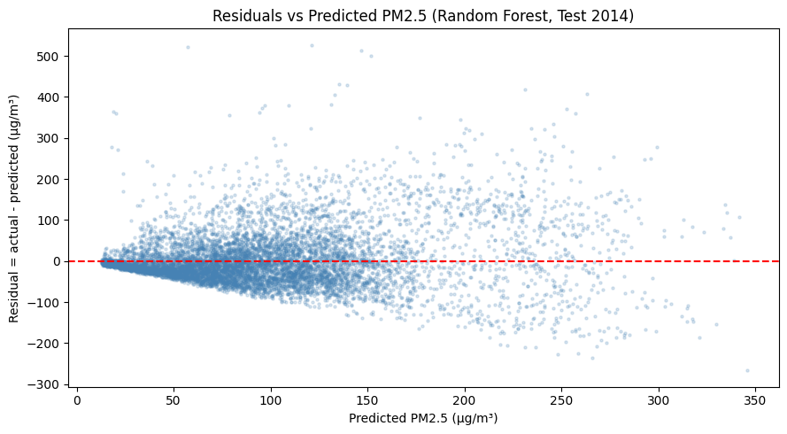
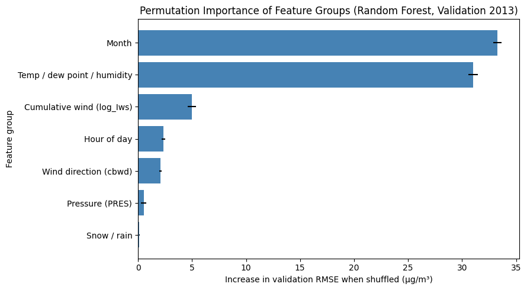

# Results and interpretation

| Model | Validation RMSE | Test MAE | Test MSE | Test RMSE | Test R² |
|---|---:|---:|---:|---:|---:|
| Random Forest (selected) | 71.889 | 45.266 | 4448.241 | 66.695 | 0.491 |
| Linear Regression (clipped) | 73.430 | 49.511 | 5075.071 | 71.240 | 0.420 |
| Decision Tree (depth 8) | 76.833 | 50.077 | 5395.474 | 73.454 | 0.383 |
| Mean baseline | 98.142 | 68.893 | 8747.145 | 93.526 | -0.000 |

Final metrics use zero-clipped predictions. Lower MAE, MSE and RMSE are better; higher R² is better. All values come from the supplied executed notebook and result CSVs.

On the 2014 test set, the Random Forest had the lowest error (MAE 45.3, RMSE 66.7 µg/m³, R² = 0.491), ahead of Linear Regression (RMSE 71.2) and the depth-8 Decision Tree (73.5). Mean residuals by predicted range stayed between approximately -4.3 and +20.9 µg/m³, but the residual standard deviation grew from 31 to 128 µg/m³ as predictions rose, showing non-constant variance. Errors were largest in February (RMSE 113.4), with underprediction in February (mean residual +58.7) and overprediction in June (-36.7). Changes between years are a possible explanation, rather than a demonstrated cause.

Permutation importance on the 2013 validation data suggested that Month (+33.3 µg/m³ RMSE) and the temperature/dew point/humidity group (+31.0) were most important. Because shuffling correlated features creates unrealistic combinations, I also refitted the forest without each group on the training data. Removing the temperature group raised validation RMSE from 71.9 to 85.5 (+13.6), removing Month raised it to 76.1 (+4.2), and removing Hour or the wind features raised it by about 1 to 2. I interpret this as the model relying mainly on temperature-related weather, with calendar information partly recoverable from other features. These are associations in one validation year; they do not show that temperature or month cause changes in PM2.5.

The error bars show standard deviation over five random shuffles, not confidence intervals over years or independent datasets. Group ablations refit on training data and score on validation data. The study does not establish causal effects.
