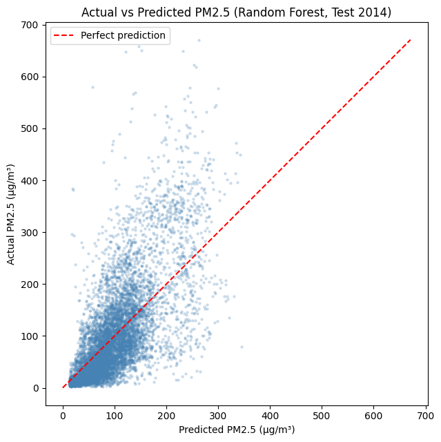

# AirCast | CFA Induction Analytics

**Estimating hourly PM2.5 from weather and calendar information**  
Adrij Sarkar · B.Tech, second year · IIT Indore · CFA Club Induction 2026

[Notebook](aircast.ipynb) · [Technical report](reports/AirCast_Technical_Report.pdf) · [Results](docs/RESULTS.md) · [Methodology](docs/METHODOLOGY.md) · [Reproduction guide](docs/REPRODUCIBILITY.md)

## The question

How well can classical regression models estimate an hour's PM2.5 concentration from the weather and calendar information available for that observation? AirCast uses the UCI Beijing PM2.5 dataset to compare a mean baseline, Linear Regression, a Decision Tree and a Random Forest under a chronological split.

This is **same-hour estimation**, not a next-day forecast: same-hour meteorological readings are required at inference time. Current and lagged PM2.5 are not model inputs.

## Main result

The Random Forest was selected using **2013 validation RMSE**. On the held-out 2014 observations, it achieved **MAE 45.266 µg/m³**, **RMSE 66.695 µg/m³** and **R² 0.491**. Its test RMSE was approximately **6.4% lower than clipped Linear Regression**. The improvement does not resolve the main weakness: severe pollution episodes remain substantially underpredicted.

| Model | Validation RMSE | Test MAE | Test MSE | Test RMSE | Test R² |
|---|---:|---:|---:|---:|---:|
| Random Forest (selected) | 71.889 | 45.266 | 4448.241 | 66.695 | 0.491 |
| Linear Regression (clipped) | 73.430 | 49.511 | 5075.071 | 71.240 | 0.420 |
| Decision Tree (depth 8) | 76.833 | 50.077 | 5395.474 | 73.454 | 0.383 |
| Mean baseline | 98.142 | 68.893 | 8747.145 | 93.526 | -0.000 |

MAE and RMSE are in µg/m³; MSE is in (µg/m³)²; R² is dimensionless. Final scores use predictions clipped at zero. The mean baseline predicts the training mean; its test R² rounds to -0.000. See the [machine-readable table](model_comparison_final.csv).



## Data and evaluation

| Item | Configuration |
|---|---|
| Source | [UCI Beijing PM2.5, ID 381](https://archive.ics.uci.edu/dataset/381/beijing+pm2+5+data) |
| Coverage | 43,824 hourly observations, 2010–2014 |
| Missing target | 2,067 rows; excluded from supervised fitting and scoring |
| Training | 2010–2012; 24,418 labelled observations |
| Validation | 2013; 8,678 labelled observations |
| Final test | 2014; 8,661 labelled observations |
| Selected model | 200-tree Random Forest; `max_features=0.5`, `min_samples_leaf=20`, seed 42 |
| Final fit | Training years only; validation was not added to final fitting |

Imputation, scaling and categorical encoding are fitted inside training-only pipelines. The notebook compares IQR and Z-score flags without automatically deleting extreme pollution readings. Engineered features capture estimated relative humidity, log cumulative wind, precipitation occurrence, and cyclical hour/month patterns.

## What the analysis found

- Training PM2.5 is right-skewed: mean 97.82 versus median 73.0 µg/m³.
- IQR flags 797 training target observations; the absolute Z-score rule flags 422. These are statistical flags, not confirmed measurement errors.
- Temperature, dew point and estimated humidity have the largest group-ablation effect: removing them raises validation RMSE from 71.889 to 85.461.
- Test hours above 250 µg/m³ are 7.7% of observations but contribute 50.5% of total squared error. This is an analysis threshold, not an official air-quality category.
- The largest prediction on the test sample is 345.6 µg/m³ versus a largest measured value of 671.0. These maxima are dataset-specific.

## Run the analysis

From this repository's root directory:

```bash
python -m pip install -r requirements.txt
jupyter lab aircast.ipynb
```

Restart the kernel and run all cells in order. Internet access is needed for `fetch_ucirepo(id=381)`. The notebook writes plots to `figures/` and the three result CSVs to the working directory. For Google Colab, upload `aircast.ipynb`, install any missing packages using the requirements list, and run all cells.

**Verification status:** documentation and CSV consistency were checked against the supplied executed notebook. Executable cells and saved results were preserved; this documentation pass did not rerun model training. Original package versions were not captured, so `requirements.txt` is a dependency list rather than an exact environment lock. [Reproduction details](docs/REPRODUCIBILITY.md).

## Repository layout

| Location | Contents |
|---|---|
| `aircast.ipynb` | Single notebook with code, saved outputs, corrected interpretation and reflections |
| `model_comparison.csv` | All four models across training, validation and test |
| `model_comparison_final.csv` | Final comparison and selection marker |
| `ablation_validation.csv` | Refitted feature-group ablation results |
| `figures/` | Eight PNG plots, including all seven required plots |
| `figures/jpg/` | JPG viewing copies of those eight figures |
| `reports/` | Six-page technical report |
| `docs/` | Methodology, results, reflections, sources, reproduction and GitHub guide |
| `data/README.md` | Data source, variable dictionary and acquisition notes |

## Limitations and next steps

Pollution and weather were measured at different locations. Missing labels are unevenly distributed over time, and this model omits emissions, neighbouring stations and recent pollution history. A single validation year does not establish robust superiority across future years. Future work should use chronological validation across multiple periods and evaluate any new features on a new untouched period; the 2014 test results are already known.

## Attribution

Dataset: Chen, S. (2015), *Beijing PM2.5*, UCI Machine Learning Repository, [doi:10.24432/C5JS49](https://doi.org/10.24432/C5JS49), CC BY 4.0. See [sources and AI assistance](docs/SOURCES.md) and the [deliverables map](docs/DELIVERABLES.md). This repository documents an induction analysis and has not been validated as an operational pollution-alert system.
